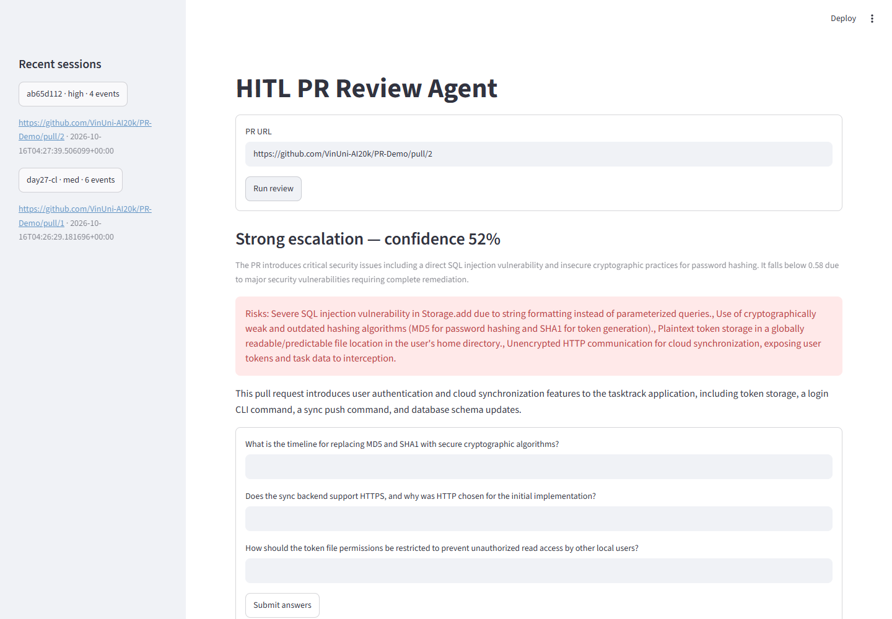
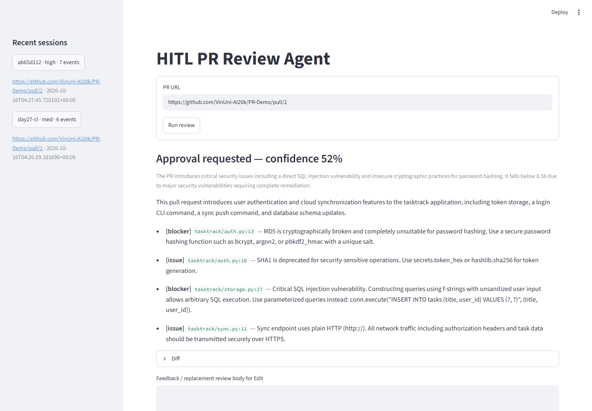
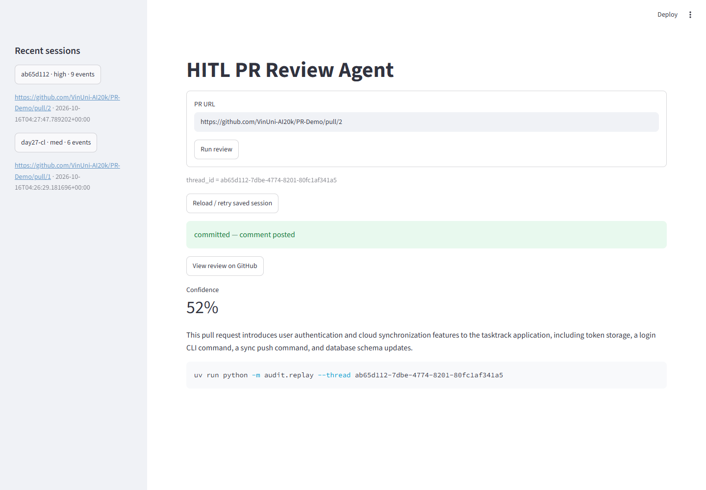
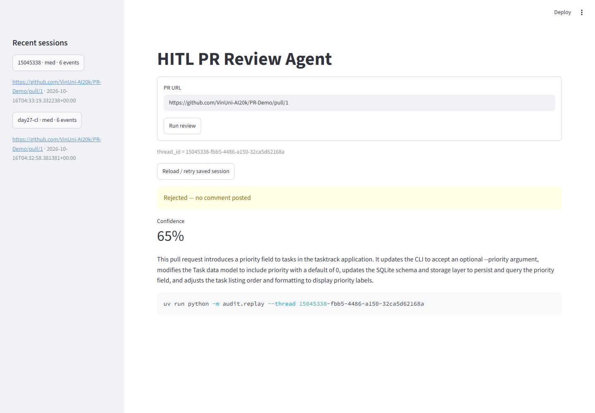

# Báo cáo Lab Day27 — HITL PR Review Agent
> Cập nhật lần cuối: 2026-10-16

**Học viên:** Nguyễn Hồng Thái — `2A202602894` — GitHub `thaijaor`.

**Link nộp:** https://github.com/thaijaor/KX-DAY27-NguyenHongThai-2A202602894

## Cách chạy từ clone mới

Yêu cầu Python 3.11+ và uv. Giữ nguyên `app.py`, `common/`, `audit/`, `exercises/`.

```bash
git clone https://github.com/thaijaor/KX-DAY27-NguyenHongThai-2A202602894.git
cd KX-DAY27-NguyenHongThai-2A202602894
uv sync
```

Tạo `.env` từ `.env.example`: macOS/Linux dùng `cp .env.example .env`; Windows PowerShell dùng `Copy-Item .env.example .env`. Điền credential của người chạy:

| Biến | Giá trị |
|---|---|
| `OPENROUTER_API_KEY` | Gemini API key; giữ tên biến có sẵn của Lab |
| `LLM_BASE_URL` | `https://generativelanguage.googleapis.com/v1beta/openai/` |
| `LLM_MODEL` | `gemini-3.5-flash-lite`, hoặc model Gemini được tài khoản hỗ trợ |
| `GITHUB_TOKEN` | Token tài khoản của người chạy, có quyền comment repo public (`public_repo` với PAT classic) |
| `HITL_DB_PATH` | Tùy chọn; mặc định `hitl_audit.db` |

Có thể dùng provider OpenAI-compatible khác bằng cách đổi **cả key, model và base URL**. Không cần sửa `common/`. Khi audit tương tác, username được lấy từ GitHub token; `GITHUB_USER` là tùy chọn nếu muốn cấu hình sẵn.

```bash
uv run python exercises/exercise_1_confidence.py --pr https://github.com/VinUni-AI20k/PR-Demo/pull/1
uv run python exercises/exercise_1_confidence.py --pr https://github.com/VinUni-AI20k/PR-Demo/pull/2
uv run python exercises/exercise_2_hitl.py --pr https://github.com/VinUni-AI20k/PR-Demo/pull/1
uv run python exercises/exercise_3_escalation.py --pr https://github.com/VinUni-AI20k/PR-Demo/pull/2
uv run python exercises/exercise_4_audit.py --pr https://github.com/VinUni-AI20k/PR-Demo/pull/1
uv run python -m audit.replay --list
uv run python -m audit.replay --thread <thread_id>
uv run streamlit run app.py
```

`approve` đăng bản review đề xuất; `reject` không đăng; `edit` đăng nội dung thay thế nhập trong feedback. Sau escalation, trả lời đủ câu hỏi rồi xác nhận review đã được tổng hợp lại. Đây là comment thảo luận trên PR, không phải thao tác Approve/merge PR của GitHub. Chỉ chạy với PR bạn được phép comment.

## Lời giải

| Phần | Triển khai |
|---|---|
| Exercise 1 | `with_structured_output(PRAnalysis)`, prompt đánh giá khả năng tự hoàn tất review, graph fetch → analyze → route và ba nhánh |
| Exercise 2 | `interrupt()` mang diff, reasoning và comments; `MemorySaver`; `Command(resume=...)`; approve/reject/edit có tác dụng riêng |
| Exercise 3 | Câu hỏi cụ thể khi rủi ro cao; đưa diff, phân tích gốc và Q&A vào synthesis; chờ xác nhận cuối trước khi đăng |
| Exercise 4 | `AuditEntry` cho từng bước; hai sự kiện trước/sau mỗi interrupt; SQLite checkpointer; tiếp tục bằng `--thread` |
| Streamlit | Nhập PR, approval card, escalation form, sidebar phiên gần đây, replay, khôi phục phiên qua URL `?thread=...` |

Ngưỡng giữ nguyên theo `common/schemas.py`: confidence **≥0.73** tự đăng, **0.58 đến dưới 0.73** xin xác nhận, **<0.58** escalation. Không gán cứng confidence theo số PR. Prompt phân biệt nhận diện được lỗi với mức sẵn sàng tự hoàn tất review.

Các side effect đăng comment nằm ở node cuối, sau interrupt. Sự kiện `pending` được kiểm tra trước khi ghi để resume không lặp dòng chờ. Audit lưu confidence hiện tại, risk, reviewer, quyết định, lý do và thời gian xử lý. `recent_threads()` dùng thứ tự rủi ro high > med > low thay vì `MAX` chuỗi. Đưa `exercises` vào package để các lệnh chạy script trực tiếp import được sau `uv sync`; không di chuyển thư mục và không sửa `common/`.

## Kết quả kiểm chứng

Chạy trên Windows, Python 3.11.9; Gemini `gemini-3.5-flash-lite`. Log lệnh và thông tin lần chạy ở [evidence/live-cli.json](evidence/live-cli.json).

| Kiểm tra thật | Kết quả | Bằng chứng |
|---|---|---|
| Exercise 1, PR #1 | 65%, `human_approval` | [Log](evidence/exercise1-pr1.txt) |
| Exercise 1, PR #2 | 55%, `escalate` | [Log](evidence/exercise1-pr2.txt) |
| Exercise 2, PR #1 | Pause → approve → `committed` | [Log](evidence/exercise2-approve.txt) |
| Exercise 3, PR #2 | 3 câu hỏi → synthesis → reject, không đăng | [Log](evidence/exercise3-escalation-reject.txt) |
| Exercise 4, PR #1 | Reject; 6 sự kiện audit; replay và list chạy được | [Log](evidence/exercise4-audit-reject.txt), [Replay](evidence/replay.txt) |
| Streamlit, PR #2 | Escalation → 3 câu trả lời → review mới → approve → `committed` | [UI run](evidence/live-ui.json), [9 sự kiện audit](evidence/ui-audit-events.json) |
| Reload trình duyệt | Khôi phục cả lúc chờ và khi đã hoàn tất; không đăng thêm comment | [UI run](evidence/live-ui.json) |
| Kiểm thử offline | 14/14 qua; routing boundaries, các quyết định, lỗi đăng/retry, reopen checkpoint, audit và UI | [tests/test_lab.py](tests/test_lab.py) |

Chạy lại kiểm thử không gọi LLM hay đăng comment:

```bash
uv run python -m unittest discover -s tests -v
```

Comment public dưới username **thaijaor**:

- [Review PR #1 từ exercise 2](https://github.com/VinUni-AI20k/PR-Demo/pull/1#issuecomment-6208061929).
- [Review PR #2 từ Streamlit sau escalation](https://github.com/VinUni-AI20k/PR-Demo/pull/2#issuecomment-6208080560).

Các lựa chọn và câu trả lời trong kiểm chứng được nhập bằng script, không phải một đánh giá độc lập của người thật. Nội dung nêu rõ đây là demo kiểm thử; approve là cho phép **đăng review**, không xác nhận code PR an toàn. Confidence của phiên UI giữ ở 52% sau Q&A vì các câu trả lời không chứng minh các blocker đã được sửa.







## Kiểm tra bản clone sạch

Đã clone mới từ GitHub tại commit code `201cd043996b046cf807c9ec62834b5f69b2c5d3`,
tạo `.env` từ `.env.example`, điền credential và chạy `uv sync --locked`.
Không chép virtualenv hay DB từ bản làm việc; không sửa code sau khi clone.

- `uv sync --locked` thành công; 14/14 test offline qua trong virtualenv mới.
- Cả 4 exercise, hai PR của exercise 1, `audit.replay --thread` và `--list` đều exit 0.
- Chạy lại exercise 4 với cùng `--thread` trong tiến trình mới: khôi phục kết quả reject, không fetch/analyze lại.
- Không cấu hình `GITHUB_USER`: audit vẫn ghi đúng `thaijaor` từ token GitHub.
- App từ clone mới mở được trên Chromium, gọi Gemini thật, hiển thị human approval và hoàn tất Reject.
- `git status --porcelain` rỗng sau khi chạy; `.env` và DB vẫn được bỏ qua.

Xem [manifest kiểm tra clone sạch](evidence/clean-validation.json),
[test log](evidence/clean-tests.txt), [sync log](evidence/clean-sync.txt)
và [log resume](evidence/clean-resume.txt). Các commit sau commit code trên chỉ bổ sung report/bằng chứng.



## Đối chiếu điều kiện nộp

- Fork đúng tên, thuộc `thaijaor`, chế độ Public; mở được bằng browser context mới chưa đăng nhập.
- Có đủ 4 exercise và `app.py`; không còn TODO hay `raise NotImplementedError` trong phần lời giải.
- Các lệnh lab và ứng dụng chạy được từ clone sạch với `.env` do người chạy tự tạo.
- Có comment review public dưới username `thaijaor`; hai link đã được kiểm lại bằng API không đăng nhập.
- `.env`, DB audit và WAL/SHM không nằm trong Git; kiểm tra exact credential và mẫu token không phát hiện secret trong file nộp.

Xem [kiểm chứng public](evidence/public-verification.json),
[ảnh fork khi chưa đăng nhập](evidence/public-fork.png) và [kiểm tra secret](evidence/security.json).
Link điền vào form nộp bài là **link fork** ở đầu report.

## Giới hạn

Confidence là đầu ra tự đánh giá của model, có thể thay đổi giữa các lần chạy. Kiểm thử offline cố định đầu ra để kiểm luật; kết quả gọi Gemini thật được ghi riêng. Không ép confidence tăng sau Q&A khi ngữ cảnh chưa đủ.

SQLite phù hợp phạm vi lab. Thời gian audit đo phần xử lý node, không bao gồm toàn bộ thời gian người dùng chờ giữa các lần chạy. Việc deduplicate sự kiện chờ và khôi phục checkpoint không bảo đảm exactly-once nếu tiến trình chết ngay sau GitHub nhận POST nhưng trước khi ghi checkpoint cuối; cần kiểm tra comment đã đăng trước khi retry trường hợp này.

`.env`, `*.db` và file WAL/SHM được gitignore. Repo chỉ chứa code, report và bằng chứng không có credential; DB audit/checkpoint là dữ liệu cục bộ, được tạo khi chạy.
